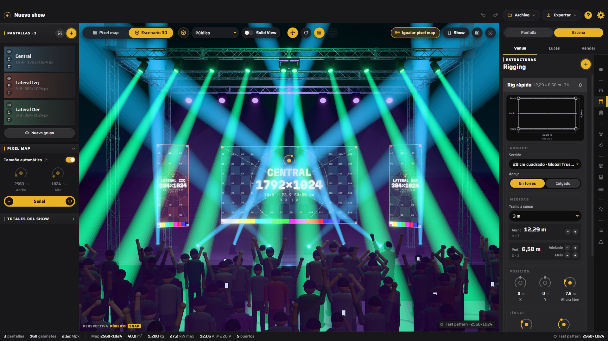
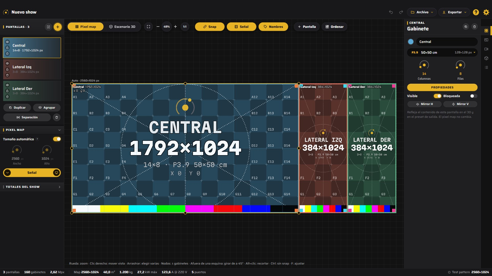
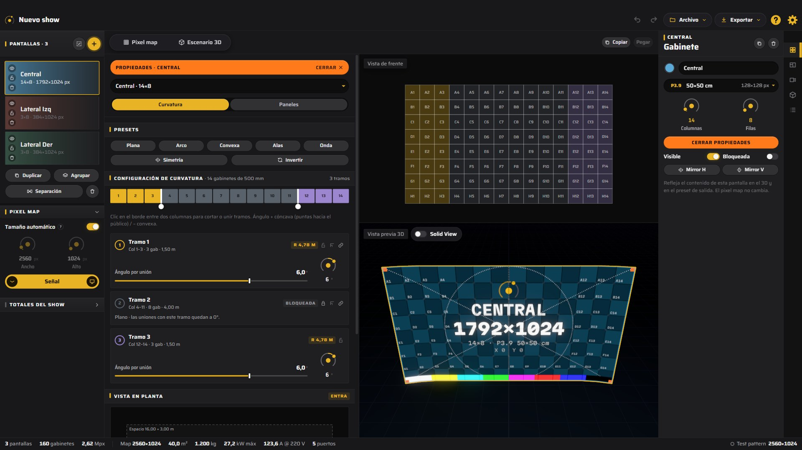
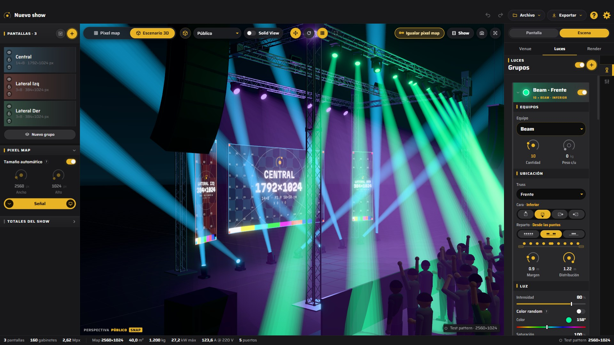

  

<h1 align="center">LED LAB by 360 LAB STUDIO</h1>

  Planificador de pantallas LED y diseño básico de stages para shows en vivo. 
  Del pixel map al escenario en 3D.

  <a href="https://github.com/garciamauro-ai/led-lab-releases/releases/latest"><b>Descargar para Windows</b></a> ·
  <a href="https://github.com/garciamauro-ai/led-lab-releases/releases">Novedades</a>

---

## Qué hace

### Pixel map
Armás el pixel map con gabinetes reales (pitch, píxeles, medidas, peso y consumo). Movés, dimensionás y
recortás pantallas al píxel. Las pantallas se ordenan en grupos con color propio y se duplican en fila con la separación
que pidas. También podés importar un preset de salida (XML de Advanced Output): cada slice se vuelve una pantalla en su lugar.

### Proyecto asistido
Arrancás con el stock de gabinetes que tenés: qué modelos y cuántos de cada uno, o los m² que vas a cubrir. A medida que
armás pantallas, una barra muestra lo que queda y avisa si te pasaste.

### Escenario 3D
Ves el show como va a quedar: pantallas con curvatura, stage con lengua, proscenio y risers, PA, sidefill, outfill, FX y
público. Vistas tipo Blender, vista técnica y un modo show con recorridos de cámara que se exporta como video.

### Estructuras y rigging
Escenarios Layher, StageDex, tarimas o a medida, con torres y techos. Rig rápido sobre torres o colgado, Truss System
tramo por tramo (con esquinas y T) y truss circular, con lista de materiales y avisos de carga. Los valores son aproximados,
sacados de las fichas de los fabricantes: todo montaje lo tiene que calcular y aprobar un ingeniero.

### Propiedades de cada pantalla
Arriba la pantalla de frente y abajo en 3D. La curvatura se arma por secciones, con quiebres de hasta 90°.
En el modo Paneles sacás o devolvés gabinetes tocándolos, o le das forma (hexágono, óvalo, rombo, triángulo).

### Luces
Grupos de equipos (beams, spots, wash, strobes, pixel bars) colgados de cualquier truss y cara, o apoyados en el piso,
repartidos parejo, desde las puntas o desde el centro. Se combinan entre sí y se manejan como una consola: color, efectos,
BPM, tap, seguir un punto y haze.

### Señal en vivo
La señal de tu software de video entra por SpoutCam o captura de pantalla y se ve en las pantallas del 3D. Cada pantalla puede
tener su propia fuente (otra salida, una cámara o un loop) con encuadre Fit / Fill / Stretch.

### Exportar
Preset de salida (XML), test pattern en PNG, modelo 3D (GLB) para Blender / Unreal / TouchDesigner, video del modo show,
captura del 3D, lista de materiales y planilla CSV con gabinetes, peso, consumo y puertos.

## Instalar

1. Bajá **LED-LAB-Setup** desde la [página de descargas](https://github.com/garciamauro-ai/led-lab-releases/releases/latest).
2. Doble clic e instalar. La primera vez Windows puede avisar que no reconoce la app: **Más información → Ejecutar igual**.
3. Listo: la app se actualiza sola. Cuando hay una versión nueva avisa y pregunta si actualizar. También se puede
   buscar a mano en **Opciones › Versión**.

> Por ahora solo Windows. La versión para Mac necesita la firma de Apple.

## Primeros pasos

1. **Nuevo proyecto** y ponele nombre (o **Nuevo proyecto asistido**, con tu stock de gabinetes).
2. En **Pantallas › +** elegís gabinete, columnas y filas. Acomodalas en el pixel map y en el escenario 3D.
3. En **Escena** armás el venue (escenario, rigging, PA) y en **Luces** cargás los equipos.
4. **Exportar** lo que necesites: preset de salida, test pattern, modelo 3D, video, captura o planilla.

Todo lo demás está en la ayuda de la app: botón **?** arriba a la derecha o tecla **F1**.

## Dónde queda cada cosa

| Qué | Dónde |
|---|---|
| Shows guardados (Ctrl+S) | `Documentos\LED Studio\proyectos` |
| Exportaciones | Donde elijas al exportar |
| Autoguardado, color de acento | En la PC (no viaja: para llevar un show a otra máquina, guardalo y copiá el `.json`) |

## Contacto

¿Encontraste un error, se te ocurrió algo que le falta o querés contar cómo la usaste en tu show?
Escribime por Instagram: **[@mavro360](https://www.instagram.com/mavro360/)**, o desde la app con **Consultas y sugerencias**
(en la ayuda y en Opciones). Las ideas que llegan terminan en las próximas versiones.
