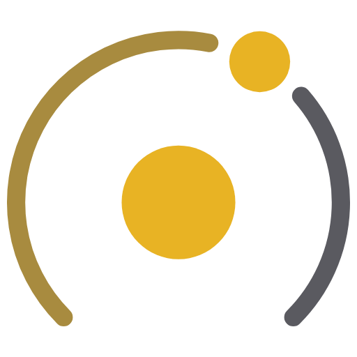

  

<h1 align="center">LED STUDIO by MAVRO360</h1>

  Planificador de pantallas LED y diseño básico de stages para shows en vivo. 
  Del pixel map al escenario en 3D.

  <a href="https://github.com/garciamauro-ai/led-studio-releases/releases/latest"><b>Descargar para Windows</b></a> ·
  <a href="https://github.com/garciamauro-ai/led-studio-releases/releases">Novedades</a>

---

## Qué hace

**Pixel map**
Armás el pixel map con gabinetes reales (pitch, píxeles, medidas, peso y consumo). Movés, dimensionás y
recortás pantallas al píxel; el lienzo se adapta solo a la disposición.

**Escenario 3D**
Ves el show como va a quedar: pantallas con curvatura, rig de truss con lingas y motores, stage con lengua, proscenio
y risers, PA, sidefill, outfill, FX y público. Vistas tipo Blender, vista técnica y un modo show con recorridos de cámara.

**Luces**
Grupos de equipos (beams, spots, wash, strobes, pixel bars) colgados de cualquier truss y cara, o apoyados en el piso.
Se combinan entre sí y se manejan como una consola: color, efectos, BPM, tap y haze.

**Señal en vivo**
La señal de tu software de video entra por SpoutCam o captura de pantalla y se ve en las pantallas del 3D. Cada pantalla puede
tener su propia fuente (otra salida, una cámara o un loop) con encuadre Fit / Fill / Stretch.

**Exportar**
Preset de salida (XML), test pattern en PNG, modelo 3D (GLB) para Blender / Unreal / TouchDesigner,
captura del 3D y planilla CSV con gabinetes, peso, consumo y puertos.

## Instalar

1. Bajá **LED-Studio-Setup** desde la [página de descargas](https://github.com/garciamauro-ai/led-studio-releases/releases/latest).
2. Doble clic e instalar. La primera vez Windows puede avisar que no reconoce la app: **Más información → Ejecutar igual**.
3. Listo: la app se actualiza sola. Cuando hay una versión nueva avisa y pregunta si actualizar. También se puede
   buscar a mano en **Opciones › Versión**.

> Por ahora solo Windows. La versión para Mac necesita la firma de Apple.

## Primeros pasos

1. **Nuevo proyecto** y ponele nombre.
2. En **Pantallas › Nueva** elegís gabinete, columnas y filas. Acomodalas en el pixel map y en el escenario 3D.
3. En **Escena** armás el venue (stage, truss, PA) y en **Luces** cargás los equipos.
4. **Exportar** lo que necesites: preset de salida, test pattern, modelo 3D, captura o planilla.

Todo lo demás está en la ayuda de la app: botón **?** arriba a la derecha o tecla **F1**.

## Dónde queda cada cosa

| Qué | Dónde |
|---|---|
| Shows guardados (Ctrl+S) | `Documentos\LED Studio\proyectos` |
| Exportaciones | Donde elijas al exportar |
| Autoguardado, color de acento | En la PC (no viaja: para llevar un show a otra máquina, guardalo y copiá el `.json`) |

## Contacto

¿Encontraste un error, se te ocurrió algo que le falta o querés contar cómo la usaste en tu show?
Escribime por Instagram: **[@mavro360](https://www.instagram.com/mavro360/)**. Las ideas que llegan terminan en las próximas versiones.
